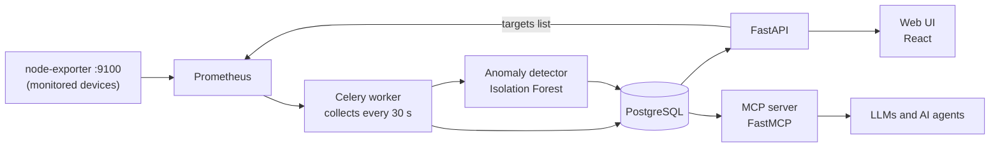

<h1 align="center">MONA - Monitor & Analytics Platform</h1>

<p align="center">
  <a href="https://github.com/gwill1337/MONA/releases"></a>
  <a href="LICENSE"></a>
  <a href="https://github.com/gwill1337/MONA/actions"></a>
  <a href="https://github.com/gwill1337/MONA/stargazers"></a>
  
</p>

<p align="center">
  
</p>

<h3 align="center">Open-source & self-hosted monitoring platform with ML anomaly detection: Prometheus and node-exporter metrics, Isolation Forest, Kubernetes or Docker Compose, and an MCP server for AI agents</h3>

<p align="center">
  <a href="https://mona-eliseyar.vercel.app/">Website</a> ·
  <a href="https://mona-eliseyar.vercel.app/demo">Live demo</a> ·
  <a href="#quick-start">Quick Start</a> ·
  <a href="#comparison-with-similar-monitoring-platforms-and-tools">Comparison</a> ·
  <a href="#how-anomaly-detection-works">How it works</a> ·
  <a href="#mcp-server-for-ai-agents">MCP server</a> ·
  <a href="#faq">FAQ</a>
</p>


## About

MONA is an open-source, self-hosted monitoring and AIOps platform. It collects CPU and RAM from your machines through Prometheus and [node-exporter](https://github.com/prometheus/node_exporter), finds anomalies with an Isolation Forest model (scikit-learn) and shows them in a web UI. A built-in [Model Context Protocol (MCP)](https://modelcontextprotocol.io/) server gives LLMs and agents the same data: devices, metrics, anomalies, health checks and model training.

It runs on Kubernetes (kind, Terraform, Helm) or Docker Compose. Backend: FastAPI, Celery, Redis, PostgreSQL. Frontend: React, Tailwind v4, TypeScript. MIT license.

## Quick Start
### Terraform:
1. Ensure [**Docker Desktop**](https://www.docker.com/products/docker-desktop/), [**kind**](https://github.com/kubernetes-sigs/kind), [**helm**](https://helm.sh/) and [**Terraform**](https://developer.hashicorp.com/terraform/install) are installed.
2. Set up node-exporter on the device you want to monitor with port 9100.
3. Clone repo `git clone https://github.com/gwill1337/MONA.git`
4. Copy `terraform.tfvars` in terraform folder from `terraform.tfvars.example`.

**For bash (Linux):**
```bash
cd terraform
cp terraform.tfvars.example terraform.tfvars
```

**For PowerShell (Windows):**
```powershell
cd terraform
Copy-Item terraform.tfvars.example terraform.tfvars
```
5. Deploy: run the automated script from the repository root:

**For bash (Linux):**
```makefile
make all
```

**For PowerShell (Windows):**
```Powershell
.\deploy.ps1 -all # or .\deploy.ps1 -deploy
```
*For manual deployment, use terraform init && terraform apply inside the /terraform folder.*

### Docker-compose (without grafana and alerting):
1. Ensure [**Docker Desktop**](https://www.docker.com/products/docker-desktop/) is installed.
2. Set up node-exporter on the device you want to monitor with port 9100.
3. Clone repo `git clone https://github.com/gwill1337/MONA.git`
4. Copy `env.example` to `.env`

**For bash (Linux):**
```bash
cp env.example .env
```

**For PowerShell (Windows):**
```powershell
Copy-Item env.example .env
```
5. Run the `docker-compose.prod.yml`:
```bash
docker compose -p mona-prod --env-file .env -f docker-compose.prod.yml up -d --build
```
*The Docker Compose version comes without Grafana, Prometheus (for the cluster), and Alertmanager.*

## Usage

The links below are available after setup.

| Service | URL | Notes |
|---|---|---|
| Admin panel | `localhost:30081` | User `admin`, password from `terraform.tfvars` or `.env` |
| Dashboards / userboard | `localhost:30081/dashboard`, `/userboard` | |
| MCP page | `localhost:30081/mcp` | Create API keys |
| Docs | `localhost:30081/docs` | |
| REST API (Swagger) | `localhost:30080/docs` | |
| MCP server (SSE) | `localhost:30082/sse` | |
| Grafana | `localhost:30300` | Kubernetes only. User `admin`, password from `terraform.tfvars` |
| Prometheus (devices) | `localhost:30391` | |
| Prometheus (cluster) | `localhost:30091` | Kubernetes only |

<details>
<summary><b>Click to view detailed API endpoints</b></summary>

### API:
*P.S. All endpoints require authentication except Prometheus and probes.*
* Swagger: `localhost:30080/docs`

#### Users:
* Users[Get]: `localhost:30080/api/v1/users`
* User[Post]: `localhost:30080/api/v1/user`
* User[Delete]: `localhost:30080/api/v1/user/{user_id}`
* UserChangePassword[Patch]: `localhost:30080/api/v1/user/change-password`
* UserChangeRole[Patch]: `localhost:30080/api/v1/user/{user_id}/role`

#### Devices:
* Devices[Get]: `localhost:30080/api/v1/devices`
* Devices[Post]: `localhost:30080/api/v1/devices`
* Devices[Delete]: `localhost:30080/api/v1/devices/{device_id}`

#### Model:
* Model-info[Get]: `localhost:30080/api/v1/model-info`
* Train[Post]: `localhost:30080/api/v1/train`
* Model[Delete]: `localhost:30080/api/v1/model`

#### Monitoring:
* Dashboard[Get]: `localhost:30080/api/v1/dashboard`
* TaskStatus[Get]: `localhost:30080/api/v1/task-status/{task_id}`
* Anomalies[Get]: `localhost:30080/api/v1/anomalies`
* Metrics[Get]: `localhost:30080/api/v1/db-metrics`

#### Authentication:
* Login[Post]: `localhost:30080/api/v1/auth/login`
* Logout[Post]: `localhost:30080/api/v1/auth/logout`
* Check auth[Get]: `localhost:30080/api/v1/auth/me`

#### Probes:
* Liveness[Get]: `localhost:30080/health/live`
* Readiness[Get]: `localhost:30080/health/ready`

#### Prometheus Endpoints:
* Metrics[Get]: `localhost:30080/metrics`
* Targets[Get]: `localhost:30080/api/prometheus/targets`

#### MCP:
* Create MCP Key[Post]: `localhost:30080/api/v1/mcp`
* MCP SSE: `localhost:30082/sse`

</details>


Devices can be set in `values.yaml`, `terraform.tfvars` or `.env` (good for bulk setup, safe from accidental deletion) or added and removed in the admin panel and API. Prometheus reads the merged list from a dedicated API endpoint.

## Comparison with similar monitoring platforms and tools

| | MONA | Netdata | Prometheus | Grafana | Zabbix | vmanomaly | Datadog |
|---|:---:|:---:|:---:|:---:|:---:|:---:|:---:|
| License | MIT | GPL-3.0<sup>1</sup> | Apache-2.0 | AGPL-3.0 | AGPL-3.0 | Enterprise license<sup>2</sup> | Proprietary SaaS |
| Built-in ML anomaly detection | ✅ | ✅ | ❌ | 🟨<sup>3</sup> | 🟨<sup>4</sup> | ✅ | ✅ |
| Detection method | Isolation Forest, CPU and RAM together | k-means per metric, all 18 models must agree | Hand-written rules | Forecast, DBSCAN/MAD | STL, baselines | Z-score, MAD, Prophet... | Proprietary |
| Data source | node-exporter via Prometheus | Netdata Agent | Exporters | Data sources | Zabbix agent, SNMP... | VictoriaMetrics | Datadog Agent |
| Official MCP server | ✅ built in | ✅ built into the Agent | ✅ prometheus-mcp<sup>5</sup> | ✅ mcp-grafana | ✅ Zabbix MCP server<sup>6</sup> | ✅ mcp-vmanomaly | ✅ remote server |
| Metric scope | CPU, RAM | Wide | Wide | Wide | Wide | Wide | Wide |
| Best for | CPU/RAM anomalies | All-in-one, real-time | Metrics and alert rules | Dashboards | Classic infra monitoring | VictoriaMetrics users | Managed SaaS |

<sup>1</sup> The Netdata Agent is GPL-3.0+. The dashboard UI and Netdata Cloud use the NCUL1 license.
<sup>2</sup> vmanomaly needs a VictoriaMetrics Enterprise license (free trial available). Its MCP server is Apache-2.0.
<sup>3</sup> Forecasting and outlier detection are documented as Grafana Cloud features.
<sup>4</sup> Statistical trigger functions (`trendstl`, `baselinedev`, `baselinewma`), not trained ML models.
<sup>5</sup> `prometheus/prometheus-mcp` lives in the Prometheus GitHub org and is still 0.x.
<sup>6</sup> Documented for Zabbix 8.0.

**MONA fits** if you already run node-exporter and Prometheus, want a per-device model that retrains automatically, or a stored model you can switch, and prefer a permissive MIT license.

**Netdata, Zabbix or Datadog fit** if you need many more metrics than CPU and RAM. Netdata also needs no setup for ML and collects every metric every second.

*Checked against vendor docs in November 2026.*

## How anomaly detection works

1. **Collect.** Every 30 seconds Celery asks Prometheus for CPU and RAM of each active device and saves a point to PostgreSQL. If there is no data (device offline), MONA saves `0.0`.
2. **Features.** Each point has 6 features: CPU, RAM, and the change of both since the previous sample (`d1`) and over the last 5 samples (`d5`, about 2.5 minutes). Deltas are not calculated across gaps longer than 90 seconds or across an offline/online switch.
3. **Check.** Every 30 seconds the detector scores the points from the last 5 minutes with an Isolation Forest model.
4. **Filter.** A point is saved as an anomaly only if its score is below `SCORE_THRESHOLD` (-0.05), CPU and RAM are not both zero, it is not a weak combined anomaly (both below 80%), and it was not saved before.
5. **Explain.** Each anomaly is stored with its score and a reason:

| Reason | Condition |
|---|---|
| High usage | CPU or RAM above 85% |
| Sudden change | CPU change above 20% or RAM above 15% between two samples |
| Change over 5 samples | CPU above 30% or RAM above 20% |
| Combined | none of the above stands out |

### Auto and Manual modes

| | Auto | Manual |
|---|---|---|
| Training data | Last `WINDOW` points per device (500 by default, at least `MIN_POINTS` = 30 clean) | A time range you choose, all devices together (at least 30 clean points) |
| Model storage | Not stored, retrained before each detection | Stored with its scaler, the 10 newest are kept (the active one is never removed) |
| When used | Default | While a model is active. If it can't be loaded, MONA falls back to Auto |

Training never uses the points being checked (last 5 minutes) or the area around known anomalies: 5 minutes before and after each, extended while CPU or RAM stays above 80%.

`CONTAMINATION = 0.05` means the model may flag up to 5% of points, even if nothing is wrong. `SCORE_THRESHOLD` and the 80% rule reduce these false positives. Model code: [ml.py](https://github.com/gwill1337/MONA/blob/main/mona_core/ml.py).

## MCP server for AI agents

The server is built with [FastMCP](https://github.com/jlowin/fastmcp), reads straight from the database and starts together with MONA (Terraform and Docker Compose). Transport is SSE at `http://localhost:30082/sse`. Authentication is an API key sent as a bearer token. An ASGI middleware checks it against the `api_keys` table on every request and returns `401` if it is missing or invalid.

Create a key on the MCP page (`localhost:30081/mcp`) or with `POST localhost:30080/api/v1/mcp`, then connect a client.

```bash
claude mcp add --transport sse mona http://localhost:30082/sse \
  --header "Authorization: Bearer <YOUR_API_KEY>"
```

Other clients (for example Cursor) need the same URL and header. The config format depends on the client:

```json
{
  "mcpServers": {
    "mona": {
      "url": "http://localhost:30082/sse",
      "headers": { "Authorization": "Bearer <YOUR_API_KEY>" }
    }
  }
}
```

Main tools: `get_mona_health`, `get_device_metrics`, `get_mona_anomalies`, `train_anomaly_model` (starts a Celery training task).

<details>
<summary>All 13 tools, prompts, resources and settings</summary>

| Tool | What it does |
|---|---|
| `get_mona_health` | Health of the MONA API, PostgreSQL, Redis and Prometheus |
| `get_device_metrics` | Paginated CPU and RAM metrics of a device |
| `get_mona_anomalies` | Anomalies, filtered by time range, device and score |
| `train_anomaly_model` | Starts an async Isolation Forest training task |
| `get_mona_devices` | Lists monitored devices |
| `add_mona_device` | Adds a device (checks for duplicates) |
| `remove_mona_device` | Removes a device by IP address |
| `get_task_status` | Status of a background task (Celery/Redis) |
| `get_model_info` | Active model metadata and number of stored models |
| `list_models` | Lists manually trained models |
| `activate_model` | Makes a stored model the active one |
| `deactivate_model` | Switches detection back to Auto |
| `get_prometheus_targets` | Prometheus scrape targets via the MONA API |

**Prompts:** `diagnose_mona` (full health check), `investigate_anomaly` (SRE workflow with before/after metrics).
**Resources:** `mona://docs/overview` (architecture), `mona://docs/metrics` (metric schemas, ML parameters, anomaly rules).

**Settings:** the MCP server has no options in `terraform.tfvars`. In Docker Compose it reads the Postgres and Redis settings from `.env`. `LOG_LEVEL` sets the log level. Two internal addresses are already set in `docker-compose.prod.yml` and the Helm chart: `MONA_API_URL` (health check, `get_prometheus_targets`) and `PROMETHEUS_URL`.

</details>


## Architecture

Helm templates can be configured in [values.yaml](https://github.com/gwill1337/MONA/blob/main/mona-chart/values.yaml) and in `terraform.tfvars`.



* **FastAPI:** REST API. ML training runs in Celery, and `/api/v1/task-status/{task_id}` reports progress through Redis.
* **Celery + Redis:** metrics collection and ML tasks. Redis also stores sessions and the rate limiter.
* **PostgreSQL:** runs as a `StatefulSet`, which gives stable pod identifiers, persistent storage linked to specific pods and ordered deployment. Tables: `devices`, `metrics`, `anomalies`, `trained_models`, `users`, `api_keys` ([db.py](https://github.com/gwill1337/MONA/blob/main/mona_core/db.py)).
* **Monitoring stack (Kubernetes):** Prometheus scrapes the data, Grafana visualizes it (the web UI also draws charts with Recharts), Alertmanager sends pod alert notifications, Loki and Promtail collect pod logs.
* **Startup and probes:** `busybox` init containers wait for the database. `/health/live` checks the API and `/health/ready` checks the database.
* **Dashboard buckets:** with a time range, `/api/v1/dashboard` averages points into 1-minute (up to 12 h), 10-minute (up to 7 days) or 1-hour buckets. `max_points` is 2000 by default, 10000 at most. Anomalies are returned as they are.

PostgreSQL can be opened via psql:
```bash
kubectl exec -it statefulset/postgres-statefulset -n mona -- psql -U myuser -d mydb
#              ⬆ pod name                          ⬆ namespace    ⬆ Username ⬆ DB name
```

## Authentication

* On login (`POST /api/v1/auth/login`) FastAPI creates a 32-byte session token and stores it in Redis for 12 hours (`ex=43200`). The browser gets it as an `HttpOnly`, `Lax` cookie named `user_session`: it is sent with every request and can't be read by scripts, which protects it from XSS.
* Roles: **admin** has full access (`GET`, `POST`, `PUT`, `DELETE`), **user** can only send `GET` requests. A missing or expired session returns `401`, a role without permission returns `403`.
* `POST /api/v1/auth/logout` deletes the session key from Redis and clears the cookie.
* On startup `seed_admin` creates the first accounts from `ADMIN_USERNAMES`, `ADMIN_PASSWORDS`, `USER_USERNAMES` and `USER_PASSWORDS` (set in `terraform.tfvars` or `.env`).
* Health probes (`/health/live`, `/health/ready`) and Prometheus endpoints (`/metrics`, `/api/prometheus/targets`) are excluded from authentication so that cluster monitoring works without credentials.

## CI

Runs on every push and pull request: Gitleaks (secrets), Checkov (IaC), Terraform fmt and validate, Helm lint, yamllint, ruff, MyPy, Pytest, Trivy (Docker images), plus Docker build and push.

## FAQ

**What does MONA monitor?** CPU and RAM of devices that run node-exporter on port 9100, one point every 30 seconds. Other metrics are not supported.

**Do I need Kubernetes?** No. Docker Compose works, without Grafana, cluster Prometheus and Alertmanager.

**What happens when a device goes offline?** MONA saves `0.0` for it. A point where both CPU and RAM are zero is never reported as an anomaly, and deltas restart after the gap.

**Can AI agents use MONA?** Yes, through the [MCP server](#mcp-server-for-ai-agents). Claude Code, Cursor and other MCP clients can read data and start training.

## License

[MIT](LICENSE). See [CONTRIBUTING.md](CONTRIBUTING.md) and the [changelog](CHANGELOG.md).